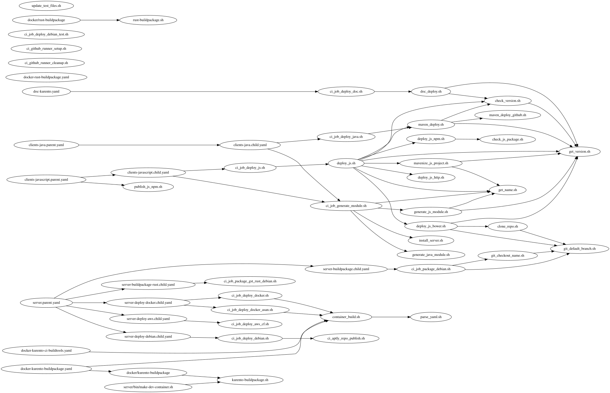

ci-scripts
==========

Scripts used for all CI actions.

* All scripts that implement CI jobs (i.e. they are meant to be called directly by a CI workflow) start with `ci_job_`.
* Miscellaneous CI utils also start with `ci_`.
* All concrete operation scripts start with a recognizable keyword; for example, the scripts related to deployment of artifacts all start with `deploy_`.

Docker image caching: the Docker image deployment jobs (`ci_job_deploy_docker*.sh`) pass the build argument `KMS_APT_STATE` to `docker buildx build`. Its value is a digest of the `Release` file of the Apt repository the image installs from (see `get_apt_repo_state.sh`). It makes the Docker layers that install Kurento packages be rebuilt whenever new packages are published, while the layers before them (base tools, repository key) stay cached. Without it, BuildKit would reuse the cached layer and publish an image with an outdated package.

Dependency graph:

Apt resilience: `apt-get update` can fail transiently while an Ubuntu mirror is being synchronized (`File has unexpected size ... Mirror sync in progress?`, `Some index files failed to download`), and a following `apt-get install` then runs with incomplete indexes. Scripts that run `apt-get update` in CI should use the function `apt_update_retry` from `bash.conf.sh` instead (`source "$SELF_DIR/bash.conf.sh"` first). It retries up to 5 times with growing waits (15, 30, 45 and 60 seconds) when the command exits with an error or its output has `Failed to fetch` errors, and, if all attempts fail, logs a WARNING and continues (returns 0, like the previous plain `apt-get update`), so that optional or flaky repositories such as Ubuntu ddebs don't break jobs that don't need them; a later `apt-get install` still fails if the indexes it needs are missing. Setting `APT_UPDATE_STRICT=true` makes it log an ERROR and return 1 instead (no script enables it for now). The waits add up to 150 seconds, but every attempt is a full `apt-get update` that may itself take long against an unresponsive host, so the worst case is several minutes. It can be tuned with the environment variables `APT_UPDATE_RETRIES`, `APT_UPDATE_DELAY`, `APT_UPDATE_DELAY_MAX` and `APT_UPDATE_STRICT`. Scripts that run in a clean container must mount `ci-scripts` and source `bash.conf.sh` there (see `ci_job_deploy_debian_test.sh`). Additionally, the `kurento-buildpackage` and `rust-buildpackage` Docker images set `Acquire::Retries "5"` in `/etc/apt/apt.conf.d/80retries` (the `kurento-ci-buildtools` image inherits it from `kurento-buildpackage`); this covers failed downloads of individual files, but not indexes with a wrong size, so it complements `apt_update_retry` rather than replacing it.
